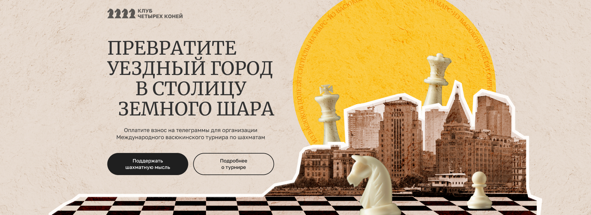

# Васюкинский турнир




**[Demo](https://alekstar79.github.io/tournament)**

---

## Оглавление

<!-- TOC -->
* [Васюкинский турнир](#васюкинский-турнир)
  * [Оглавление](#оглавление)
  * [О проекте](#о-проекте)
  * [Ключевые особенности](#ключевые-особенности)
  * [Техническая реализация](#техническая-реализация)
    * [Архитектура CSS и адаптивность](#архитектура-css-и-адаптивность)
    * [Адаптивная сцена в Hero](#адаптивная-сцена-в-hero)
    * [Слайдер «Этапы преображения Васюков»](#слайдер-этапы-преображения-васюков)
    * [Бесконечная карусель «Участники турнира»](#бесконечная-карусель-участники-турнира)
    * [Бегущая строка (Ticker)](#бегущая-строка-ticker)
    * [Анимации появления](#анимации-появления)
  * [Доступность](#доступность)
  * [Производительность](#производительность)
  * [Структура проекта](#структура-проекта)
<!-- TOC -->

---

## О проекте

Одностраничный лендинг демонстрирует вёрстку и интерактивные компоненты, реализованные на чистом HTML, CSS и модульном JavaScript без сборки и сторонних фреймворков. Макет рассчитан на экраны от 375px до 1920px и выше; разметка использует семантические элементы и ARIA-атрибуты.

---

## Ключевые особенности

- **Адаптивный дизайн** — сцена Hero переключается на desktop-режим с 768px; высота Hero составляет 580px от 768px, 620px от 900px, 660px от 1100px и 700px от 1280px.
- **Два типа каруселей:**
  - Слайдер «Этапы» на мобильных и планшетах, перестраивающийся в статичную сетку на десктопах (≥1200px). Не зациклен, кнопки блокируются на крайних слайдах.
  - Бесконечная карусель «Участники» показывает 1, 2 или 3 карточки на ширинах до 599px, 600–1024px и от 1025px соответственно. Автопрокрутка приостанавливается при наведении и при скрытой вкладке.
- **CSS-only адаптивная сцена** в Hero‑блоке — позиционирование и масштабирование всех декоративных элементов полностью управляются стилями (проценты, `aspect-ratio`, `clamp()`).
- **Бегущая строка (marquee)** генерируется из HTML-шаблона. На ширинах до 1024px она расположена внутри Hero и footer; от 1025px — между Hero и main, а также между main и footer. CSS-анимация приостанавливается при наведении.
- **Плавные анимации появления** блоков при скролле на базе IntersectionObserver.
- **Слои CSS и токены** задают порядок каскада и централизованные значения палитры и типографики; container query адаптирует текст карточек этапов по ширине компонента.
- **Семантическая разметка** и поддержка скринридеров (ARIA-атрибуты, навигация с клавиатуры).
- **Оптимизация производительности**: минимум перерасчётов стилей, асинхронные операции, отключение неактивных компонентов.

---

## Техническая реализация

### Архитектура CSS и адаптивность

Стили организованы каскадными слоями `reset`, `tokens`, `base`, `layout`, `components` и `utilities`. CSS-переменные в слое `tokens` содержат общую палитру, шрифты и ширину контентного контейнера.

Container query `stage-group` задаёт размер текста карточек этапов по ширине группы. Базовое значение `clamp()` сохраняет адаптивный размер текста в браузерах без поддержки container queries. Глобальные переходы между режимами сцены и каруселей по-прежнему управляются `@media`.

Основные пороги интерфейса:

- Сцена Hero переходит в desktop-режим с 768px; её высота меняется на 580px, 620px, 660px и 700px при ширинах 768px, 900px, 1100px и 1280px соответственно.
- Карусель участников показывает 1 слайд до 600px, 2 слайда от 600px до 1024px и 3 слайда от 1025px.
- Слайдер этапов отображается до 1199px; с 1200px контент представлен трёхколоночной сеткой.

### Адаптивная сцена в Hero

Hero‑блок объединяет фоновую текстуру, городской силуэт, шахматные фигуры и круговой текст. Все элементы позиционируются и масштабируются исключительно средствами CSS:

- **Мобильная версия (375px):** сцена имеет фиксированные размеры 375×812px и привязывается к верхнему краю hero. Координаты всех внутренних элементов заданы в процентах от этих базовых значений.
- **Desktop-режим (от 768px):** пропорции сцены заданы как `aspect-ratio: 1366 / 700`; высота соответствует текущей высоте Hero. Ширина вычисляется автоматически, элементы позиционируются относительно базовой сцены 1366×700.
- **Адаптивные брейкпоинты высоты hero** (580px, 620px, 660px, 700px) обеспечивают плавное изменение высоты при разных разрешениях.
- Все изображения используют `width: X%`, `left: Y%`, `top: Z%` и `height: auto`, что гарантирует сохранение пропорций без искажений.
- Бегущая строка на мобильных абсолютно позиционирована внутри hero (`bottom: 0`) и накладывается на сцену, не влияя на её геометрию.

Благодаря такому подходу сцена точно соответствует макету на контрольных точках 375 px и 1366 px и адаптивно масштабируется между ними без участия JavaScript.

### Слайдер «Этапы преображения Васюков»

Компонент имеет два режима в зависимости от ширины экрана:

- **Мобильные и планшеты (< 1200px):** работает как незацикленный слайдер с кнопками «вперёд/назад» и точками-индикаторами. Переключение реализовано через `transform: translateX()` с CSS‑переходом (`0.35s ease`). На первом слайде кнопка «Назад» неактивна, на последнем — «Вперёд». Цвета кнопок: `#313131` в обычном состоянии, `#FBCE51` при наведении, полупрозрачный вариант `rgba(49,49,49,0.2)` для недоступных кнопок.
- **Десктопы (≥ 1200 px):** JavaScript переводит слайдер в неактивное состояние и сбрасывает inline-трансформацию; CSS перестраивает контент в трёхколоночную сетку (`grid-template-columns: repeat(3, 1fr)`) и скрывает навигацию.

Точки-индикаторы синхронизируются с текущим индексом и обновляют атрибут `aria-selected`. Переходы за границы запрещены — проверка индекса предотвращает циклический проход.

### Бесконечная карусель «Участники турнира»

Бесконечная лента реализована через клонирование слайдов и автоматическую прокрутку:

- **Клонирование:** перед началом и после конца оригинального списка добавляются копии первых/последних `visibleCount` элементов (1, 2 или 3 в зависимости от ширины экрана), создавая иллюзию непрерывности.
- **Ширина карусели:** на viewport до 599px виден один слайд, от 600px до 1024px — два, от 1025px — три.
- **Перемещение:** `transform: translateX()` с шагом, равным ширине одного слайда плюс gap. Шаг пересчитывается при инициализации и ресайзе.
- **Автопрокрутка:** `setInterval` каждые 4 секунды сдвигает ленту вперёд. При наведении мыши на вьюпорт автоплей приостанавливается (`mouseenter`/`mouseleave`). Если вкладка браузера скрывается (`visibilitychange`), прокрутка останавливается и возобновляется только при возврате пользователя (если не было наведения).
- **Защита от двойных нажатий:** флаг `isMoving` предотвращает запуск нового перехода до завершения текущей анимации (событие `transitionend` или тайм-аут 400 мс).
- **Асинхронная инициализация:** модуль дожидается полной загрузки всех изображений внутри слайдов. После этого один кадр `requestAnimationFrame` гарантирует актуальные размеры, затем вычисляется шаг и лента позиционируется на первый реальный слайд. Это исключает ситуацию, когда начальный сдвиг оказывается неверным из-за ещё не загруженных картинок.
- **Счётчик страниц:** отображает номер текущего первого видимого слайда относительно оригинального списка, корректно работая с клонированными элементами.

### Бегущая строка (Ticker)

Текстовая лента с повторяющимся содержимым генерируется динамически из `<template id="ticker-template">`:

- Модуль `ticker.js` создаёт экземпляры тикера в нужных местах страницы (внутри hero, в подвале, между секциями).
- До 1024px видны варианты внутри Hero и footer; начиная с 1025px видны варианты между Hero и main, а также между main и footer.
- Каждый трек содержит две копии набора элементов, что вместе с CSS‑анимацией `marquee` создаёт визуально бесконечную прокрутку. При наведении анимация ставится на паузу.
- Разные экземпляры тикера позиционируются с помощью CSS‑классов.

### Анимации появления

Для блоков с классом `.animate` используется `IntersectionObserver`. Когда элемент попадает в область просмотра (порог 15%), ему добавляется класс `.visible`, который запускает CSS‑переходы прозрачности и сдвига. Observer отключается после первого срабатывания, не создавая лишней нагрузки.

---

## Доступность

- **Семантическая вёрстка:** используются `<header>`, `<main>`, `<section>`, `<article>`, `<nav>`, `<footer>`.
- **ARIA‑атрибуты:** `aria-label` у кнопок и навигационных областей, `aria-live="polite"` для счётчика страниц, `aria-selected` для точек слайдера, `role="tablist"` и `role="tab"` для индикаторов этапов.
- **Декоративные элементы скрыты** от скринридеров с помощью `aria-hidden="true"` и пустых `alt`.
- **Фокус клавиатуры** обозначается стилем `:focus-visible` для ссылок и кнопок.

---

## Производительность

- **Анимации перемещения** используют `transform`; появления блоков — `opacity` и `transform`.
- **Сцена Hero управляется CSS** без JavaScript-обработчика resize.
- **Слайдер этапов на desktop** неактивен, inline-трансформация сброшена, а сетка и навигация определяются CSS.
- **Карусель участников** дожидается загрузки изображений и объединяет resize-обновления с задержкой 200 мс.
- **События** навешиваются прицельно на конкретные элементы без избыточного делегирования.

---

## Структура проекта

```text
tournament/
├── index.html
├── favicon.png
├── hero.jpg
├── LICENSE
├── README.md
└── assets/
    ├── styles.css
    ├── main.js                    # точка входа, инициализация
    ├── utils.js                   # общие утилиты (ready, расчёт видимых слайдов, анимации появления)
    ├── ticker.js                  # логика бегущей строки
    ├── stagesCarousel.js          # логика незацикленной карусели этапов
    ├── participantsCarousel.js    # логика бесконечной карусели участников
    └── img/                       # изображения
```
